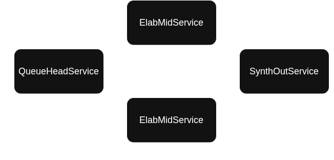

# peerMoA

Tool for MMLU benchmarks on [HuggingFace datasets](https://github.com/huggingface/datasets) on distributed layers of [Mixture-Of-Agent](https://github.com/togethercomputer/MoA) approach based on [ECLYPSE framework](https://github.com/eclypse-org/eclypse) and [ollama](https://ollama.com/).

UNIPI Bachelor thesis's project.

The tool implements two alternative Mixture-of-Agent scheduling schemes on top of the same benchmark pipeline:
- **Push** — the original MoA layer structure, where a fixed pipeline of agents pushes the message forward layer by layer.
- **Pull** — a shared-queue scheme proposed for this thesis, where worker agents pull tasks from a central queue and requeue partially elaborated ones until a "virtual layer" is complete.

## Installing

Before installing this python script **make sure** that you [installed ollama](https://ollama.com/download/linux) and an **SML**.

```BASH
ollama pull [your_model]
```

After that you can clone the repo and **setup the script** using a `venv`:

```BASH
git clone https://github.com/Peenguino/peerMoA.git
cd ./peerMoA
python3 -m venv .venv
source .venv/bin/activate
pip install -r requirements.txt
```

> For deploy notes on specific machines/architectures (ARM VM without sudo, AMD GPU through the ollama service, ...) see [`docs/setup_notes.md`](./docs/setup_notes.md).

## Running

To launch the tool use the `./run.sh` script.

### Runtime UI

The UI asks each time configurations for the benchmark: the ollama model, the MMLU topic, which `Application` to run (`singleAgentApplication`, `layerApplication` or `pullApplication`) and, based on that choice, the number of layers/workers and, for the pull scheme, the **requeue policy**.

https://github.com/user-attachments/assets/50e76da3-9e35-4367-938a-3471c6b1d5d3

### Run naming

Each run is named after the configuration it belongs to, so it is identifiable from the log directory alone: `logs/<TAG>_<timestamp>/`, where `<TAG>` is composed as:

- `SAA` / `LA` / `PULL` — the short name of the selected `Application`.
- `LOCAL` / `DIST` — whether it ran on a single machine (`PEERMOA_RUN_MODE=local`) or on a cluster (`dist_strict`/`dist_dynamic`).
- `HEAD` / `TAIL` — only for `PULL`, the selected requeue policy.

e.g. `PULL-DIST-HEAD_20260809_1120`, `LA-DIST_20260808_1712`.

## Architecture

This project is based on [ECLYPSE framework](https://github.com/eclypse-org/eclypse), so each `Application` or `Service` is a subclass of their implementations.

### Services

Each service represent an agent, their behaviour is described into the `step()` function (or, for REST-driven services, into their endpoint handlers).

Each agent got an atomic role, so we are deploying same agents but in a different graph, defined by the `Application`.

#### Push scheme

They stores **agents behaviour**, each one got a *specific role*:
- [`HeadBenchmarkService`](./src/services/benchmarkServices.py)
    - Agent that starts the benchmark, his role is to read the questions in the dataset of the selected topic, sending the message in the [`messageDictTemplate`](./src/utils/messageDictUtils.py).
- [`InputNodeService`](./src/services/inputNodeService.py)
    - The first agent of the [`LayerApplication`](./src/applications/layerApplication.py).
        - His role it's to broadcast the current message to the next three [`MidNodeServices`](./src/services/midNodeService.py).
- [`MidNodeService`](./src/services/midNodeService.py)
    - Agent that calls the selected model. He waits the questions and uses them to generate the prompt.
    - After the response from the model he sends to all his neighbours the message in the [`messageDictTemplate`](./src/utils/messageDictUtils.py) writing the generated text *value* at the `generatedText` *key* into `messageDict` map.
    - This service uses an high temperature value $t$.
    - The interaction with the model it's based on *system/user* format prompt:
        - `System Prompt` Describes meta informations, so for this `Service`
            - If the `Service` it's placed in the first `ApplicationLayer` the system prompt describes the service behaviour without any previous generated answer.
            - If the `Service` it's placed in any other position the system prompt describes the service behaviour using the answer generated from the previous `OutputNodeService`.
        - `User Prompt` Describes the real prompt, in this case the question from the dataset's entry.
- [`OutputNodeService`](./src/services/outputNodeService.py)
    - It waits for each of the previous layer's `Services`, the count it's defined in the constructor.
    - This service uses a low temperature $t$ value, because his role it's to synthesize previous generated text into the correct answer to the asked question.
    - The interaction with the model it's based on *system/user* prompt.
    - **Char/String Synth**: The goal is to compute the score for each layer and the final score, so we are following two approaches:
        - **Char Synth**: A `OutputNodeService` always computes a `char`, this is added on a list in the `messageDict`. Each char will be used in the `TailBenchmarkService` to compute partials and final score.
        - **String Synth**: To keep alive the MoA strategy the `OutputNodeService` also computes a `String`. This one will be used by `MidNodeServices` from next layer, so they can synth using previous responses.
- [`TailBenchmarkService`](./src/services/benchmarkServices.py)
    - His role it's to handle a `messageDict` and compare two fields `expectedAnswer` and `predictedAnswer`, after that it sends an ACK to `HeadBenchmarkService`.
    - At the end it print the score, using the count calculated before.

#### Pull scheme

Instead of a fixed pipeline, workers pull work from a shared queue and the same task can circulate through several **virtual layers** until it is fully elaborated. Communication is REST-based (`RESTService`), not message passing:

- [`QueueHeadService`](./src/services/pull_queueHeadService.py)
    - Central task manager. On deploy it loads the MMLU dataset for the selected topic and progressively fills an internal queue (`target_queue_size`) instead of loading it all at once, to avoid OOM.
    - `GET /pull` — a worker asks for a task; the head pops one from the queue and, if a task is pulled for the first time, starts its E2E latency timer. It replenishes the queue from the dataset right after.
    - `POST /requeue` — a worker gives back a partially elaborated task. Where it lands depends on the **requeue policy**:
        - `head` — reinserted at the front (`appendleft`): priority to work already in progress, so a task finishes its layer sooner. In a distributed deploy a co-located worker can immediately re-pull what it just requeued, starving remote workers.
        - `tail` — reinserted at the back (`append`): fairer across workers, breaking that self-feeding loop, at the cost of more work in progress and higher end-to-end latency.
- [`ElabMidService`](./src/services/pull_elabMidService.py)
    - Worker agent, equivalent role to `MidNodeService` but pull-driven: `step()` pulls a task from `QueueHeadService/pull`, calls the selected model on the accumulated elaborations (plus the previous virtual layer's synthesis, if any) with a high temperature $t$, then either `POST`s it to `QueueHeadService/requeue` (if it needs more elaborations in the current virtual layer) or to `SynthOutService/synthesize` once it reached `max_elaborations`.
    - Talks to its own `ollama_host`, so each worker can point at a different Ollama instance (see [Ollama host mapping](#ollama-host-mapping-pull) below).
- [`SynthOutService`](./src/services/pull_synthOutService.py)
    - Equivalent role to `OutputNodeService` + `TailBenchmarkService`. `POST /synthesize` queues the task on an internal `asyncio.Queue`, processed by a pool of concurrent background workers so the REST endpoint returns immediately.
    - If the task hasn't reached `max_layers` yet, it synthesizes a **String** summary (low count reset, `layer_count` incremented) and sends it back to `QueueHeadService/requeue` to start the next virtual layer.
    - Otherwise it synthesizes the final **Char** answer (A/B/C/D, low temperature $t$), compares it against `expectedAnswer` and updates the running accuracy/throughput/E2E-latency metrics.
    - Once every expected task has come back, it logs the final metrics and sends `SIGINT` to the main process to end the simulation.

### Applications

In the `Application` we define how agents interacts with each other, deploying them in a graph.

So using applications we can compose `Services`.

#### Fixed Applications

- The tool offers some fixed `Applications`:

##### [1. *`SingleAgentApplication`*](./src/applications/singleAgentApplication.py)

It offers a single agent deploy, used to test the model without the Mixture of Agent approach on the benchmark's selected topic.

<p align="center">
    
</p>

There are two `NodeService`, but the `OutputNodeService` calls the model on low temperature, his role it's to choose the correct option answer on the knowledge shared by the `MidNodeService`.

##### [2. *`LayerApplication`*](./src/applications/layerApplication.py)

**Pipeline** built on this **Layer structure** from the Mixture of Agent approach (Push scheme).

<p align="center">
    
</p>

The middle part (`InputNodeService`, `MidNodeService`, `OutputNodeService`) will be **replicated** based on the **value asked in UI** (number of layers, 1 to 3).

##### [3. *`PullApplication`*](./src/applications/pull_layerApplication.py)

Shared-queue implementation of the Pull scheme, built out of `QueueHeadService`, `SynthOutService` and `N` `ElabMidService` workers, all wired together over REST edges:

<p align="center">
    
</p>

Configured through the interactive UI (or `get_pull_application(...)`) with:
- `num_workers` — number of `ElabMidService` workers deployed (equivalent load to the Push scheme is `num_layers * agents_per_layer`).
- `requeue_policy` — `"head"` or `"tail"`, see [`QueueHeadService`](#pull-scheme) above.
- `ollama_hosts` — optional per-worker Ollama endpoint mapping, see [below](#ollama-host-mapping-pull).

## Distributed Cluster Deploy

Deploy is based on [Ray](https://www.ray.io/), driven by `PEERMOA_RUN_MODE`:

| Mode | `PEERMOA_RUN_MODE` | Placement |
| ---- | ------------------- | --------- |
| Local | `local` (default) | Single machine, no Ray cluster. |
| Fixed cluster | `dist_strict` | Each machine advertises Ray custom resource tags (one per `Service`/`Node`), and the deploy strategy pins every agent to its tag — the **fixed** Service ↔ Machine mapping is decided up front. |

Scripts live under [`dist/dist_running_scripts/`](./dist/dist_running_scripts/), with example resource maps under [`dist/dist_fixed_configs/`](./dist/dist_fixed_configs/).

### Fixed placement (`dist_strict`)

Each machine requires `uv` to install the pinned version of Python:

```sh
# If uv is not installed
curl -LsSf https://astral.sh/uv/install.sh | sh

# Setup venv and installing dependencies
uv venv
uv pip install -r requirements.txt
```

Every machine runs [`master_fixed_start.sh`](./dist/dist_running_scripts/fixed_start/master_fixed_start.sh) (one master) or [`worker_fixed_start.sh`](./dist/dist_running_scripts/fixed_start/worker_fixed_start.sh) (the others), passing a JSON file of `{"ResourceTag": 1, ...}` that declares which agents that machine is allowed to host. The master auto-detects its own IP from the default route and prints the exact `PEERMOA_MASTER_IP=...` line to reuse on the workers (override with `PEERMOA_MASTER_IP=x.x.x.x` if needed); workers fail fast with a readable error instead of waiting on Ray's GCS timeout if the master isn't reachable yet.

#### Push / `layerApplication` example (3 machines, 3 layers)

- **Machine A (Master)** — [`machine_a_master.json`](./dist/dist_fixed_configs/machine_a_master.json):
    ```json
    {
        "HeadBenchmarkNode": 1,
        "TailBenchmarkNode": 1,
        "MidNode-L1-(1)": 1,
        "MidNode-L2-(1)": 1,
        "MidNode-L3-(1)": 1,
        "InputNode-L1": 1,
        "OutputNode-L1": 1
    }
    ```
- **Machine B (Worker)** — [`machine_b_worker.json`](./dist/dist_fixed_configs/machine_b_worker.json):
    ```json
    {
        "MidNode-L1-(2)": 1,
        "MidNode-L2-(2)": 1,
        "MidNode-L3-(2)": 1,
        "InputNode-L2": 1,
        "OutputNode-L2": 1
    }
    ```
- **Machine C (Worker)** — [`machine_c_worker.json`](./dist/dist_fixed_configs/machine_c_worker.json):
    ```json
    {
        "MidNode-L1-(3)": 1,
        "MidNode-L2-(3)": 1,
        "MidNode-L3-(3)": 1,
        "InputNode-L3": 1,
        "OutputNode-L3": 1
    }
    ```

Wrapper scripts at the repo root pin each machine to its config:

```sh
# On Machine A
./run_master_a.sh

# On Machine B
./run_worker_b.sh

# On Machine C
./run_worker_c.sh
```

We suggest running the master first, letting it stop on the model choice, then the workers.

#### Pull / `pullApplication` example (3 machines, equivalent load)

At parity of load with the 3×3 push example above (9 elaborations per query), see [`dist/dist_running_scripts/fixed_start/README_pull_multi_host.md`](./dist/dist_running_scripts/fixed_start/README_pull_multi_host.md):

| Config | Actors hosted |
| ------ | ------------- |
| [`machine_master_pull.json`](./dist/dist_running_scripts/fixed_start/machine_master_pull.json) | `QueueHeadNode`, `SynthOutNode`, `ElabMidNode-1` |
| [`machine_worker_2_pull.json`](./dist/dist_running_scripts/fixed_start/machine_worker_2_pull.json) | `ElabMidNode-2` |
| [`machine_worker_3_pull.json`](./dist/dist_running_scripts/fixed_start/machine_worker_3_pull.json) | `ElabMidNode-3` |

```sh
# On the master
./dist/dist_running_scripts/fixed_start/master_fixed_start.sh dist/dist_running_scripts/fixed_start/machine_master_pull.json

# On each worker, with the IP printed by the master
PEERMOA_MASTER_IP=<ip-master> ./dist/dist_running_scripts/fixed_start/worker_fixed_start.sh dist/dist_running_scripts/fixed_start/machine_worker_2_pull.json
PEERMOA_MASTER_IP=<ip-master> ./dist/dist_running_scripts/fixed_start/worker_fixed_start.sh dist/dist_running_scripts/fixed_start/machine_worker_3_pull.json
```

Then, in the master's interactive UI: application `pullApplication`, number of worker nodes = 3. Each `ElabMidService` talks to the Ollama instance running on **its own** machine (`127.0.0.1:11434`) — no need to expose Ollama on the LAN.

#### Ollama host mapping (pull)

[`dist/dist_fixed_configs/pull_ollama_hosts.json`](./dist/dist_fixed_configs/pull_ollama_hosts.json) maps each `ElabMidService-N` to an explicit Ollama URL:

```json
{
  "ElabMidService-1": "http://192.168.1.11:11434",
  "ElabMidService-2": "http://192.168.1.12:11434",
  "ElabMidService-3": "http://192.168.1.100:11434"
}
```

This is **not** used in the multi-machine flow above (each `*_fixed_start.sh` script unsets `PEERMOA_PULL_OLLAMA_HOSTS`/`PEERMOA_PULL_OLLAMA_HOSTS_FILE`, so every worker falls back to its own `127.0.0.1:11434`, which is correct once the actors are already distributed on physical machines). It's only useful to point a **single, non-distributed** pull run at several remote Ollama instances at once:

```sh
export PEERMOA_PULL_OLLAMA_HOSTS_FILE=/path/to/pull_ollama_hosts.json
# or inline:
export PEERMOA_PULL_OLLAMA_HOSTS='{"ElabMidService-1": "http://192.168.1.11:11434"}'
```

## Further documentation

- [`docs/setup_notes.md`](./docs/setup_notes.md) — environment-specific setup notes (ARM VM without sudo, AMD GPU through the ollama service, ...).
- [`./docs/benchmark_6_conf.md`](./docs/benchmark_6_conf.md) — the six push/pull benchmark configurations used to compare the two schemes, and their results.
