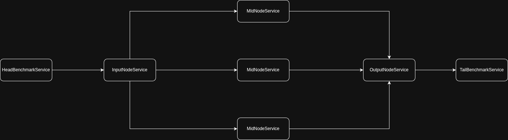

# peerMoA

Tool for MMLU benchmarks on [HuggingFace datasets](https://github.com/huggingface/datasets) on distributed layers of [Mixture-Of-Agent](https://github.com/togethercomputer/MoA) approach based on [ECLYPSE framework](https://github.com/eclypse-org/eclypse) and [ollama](https://ollama.com/).

UNIPI Bachelor thesis's project.

## Installing

Before installing this python script **make sure** that you [installed ollama](https://ollama.com/download/linux) and an **SML**.

```BASH
ollama pull [your_model]
```

After that you can clone the repo and **setup the script** using a `venv`:

```BASH
git clone https://github.com/Peenguino/peerMoA.git
cd ./peerMoA
python3 -m venv .venv
source .venv/bin/activate
pip install -r requirements.txt
```

## Running

To launch the tool use the `./run.sh` script.

### Runtime UI

The UI asks each time configurations for the benchmark:

https://github.com/user-attachments/assets/50e76da3-9e35-4367-938a-3471c6b1d5d3

## Architecture

This project is based on [ECLYPSE framework](https://github.com/eclypse-org/eclypse), so each `Application` or `Service` is a subclass of their implementations.

### Services

Each service represent an agent, their behaviour is described into the `step()` function.

Each agent got an atomic role, so we are deploying same agents but in a different graph, defined by the `Application`.

They stores **agents behaviour**, each one got a *specific role*:
- [`HeadBenchmarkService`](./src/services/benchmarkServices.py)
    - Agent that starts the benchmark, his role is to read the questions in the dataset of the selected topic, sending the message in the [`messageDictTemplate`](./src/utils/messageDictUtils.py).
- [`InputNodeService`](./src/services/inputNodeService.py)
    - The first agent of the [`LayerApplication`](../applications/layerApplication.py). 
        - His role it's to broadcast the current message to the next three [`MidNodeServices`](./midNodeService.py).
- [`MidNodeService`](./src/services/midNodeService.py)
    - Agent that calls the selected model. He waits the questions and uses them to generate the prompt.
    - After the response from the model he sends to all his neighbours the message in the [`messageDictTemplate`](./src/utils/messageDictUtils.py) writing the generated text *value* at the `generatedText` *key* into `messageDict` map.
    - This service uses an high temperature value $t$.
    - The interaction with the model it's based on *system/user* format prompt:
        - `System Prompt` Describes meta informations, so for this `Service`
            - If the `Service` it's placed in the first `ApplicationLayer` the system prompt describes the service behaviour without any previous generated answer.
            - If the `Service` it's placed in any other position the system prompt describes the service behaviour using the answer generated from the previous `OutputNodeService`.
        - `User Prompt` Describes the real prompt, in this case the question from the dataset's entry.

- [`OutputNodeService`](./src/services/outputNodeService.py)
    - It waits for each of the previous layer's `Services`, the count it's defined in the constructor.
    - This service uses a low temperature $t$ value, because his role it's to synthesize previous generated text into the correct answer to the asked question.
    - The interaction with the model it's based on *system/user* prompt.
    - **Char/String Synth**: The goal is to compute the score for each layer and the final score, so we are following two approaches:
        - **Char Synth**: A `OutputNodeService` always computes a `char`, this is added on a list in the `messageDict`. Each char will be used in the `TailBenchmarkService` to compute partials and final score.
        - **String Synth**: To keep alive the MoA strategy the `OutputNodeService` also computes a `String`. This one will be used by `MidNodeServices` from next layer, so they can synth using previous responses.
- [`TailBenchmarkService`](./src/services/benchmarkServices.py)
    - His role it's to handle a `messageDict` and compare two fields `expectedAnswer` and `predictedAnswer`, after that it sends an ACK to `HeadBenchmarkService`.
    - At the end it print the score, using the count calculated before.

### Applications

In the `Application` we define how agents interacts with each other, deploying them in a graph.

So using applications we can compose `Services`.

#### Fixed Applications

- The tool offers some fixed `Applications`:

##### [1. *`SingleAgentApplication`*](./src/applications/singleAgentApplication.py)

It offers a single agent deploy, used to test the model without the Mixture of Agent approach on the benchmark's selected topic.

<p align="center">
    
</p>

There are two `NodeService`, but the `OutputNodeService` calls the model on low temperature, his role it's to choose the correct option answer on the knowledge shared by the `MidNodeService`.

##### [2. *`LayerApplication`*](./src/applications/layerApplication.py)

**Pipeline** built on this **Layer structure** from the Mixture of Agent approach.

<p align="center">
    
</p>

The middle part (`InputNodeService`, `MidNodeService`, `OutputNodeService`) will be **replicated** based on the **value asked in UI**.

#### Distributed Applications

- next

## Setup Benchmarks on ARM VM

List of commands used to setup peerMoA on an ARM VM, no sudo permission.

```sh
# Downloading ollama binaries
curl -L https://github.com/ollama/ollama/releases/download/v0.21.0/ollama-linux-arm64.tar.zst -o ollama.tar.zst
# Extracting ollama
tar -xf ollama.tar.zst
# Launching it in background
nohup ./bin/ollama serve > ollama.log 2>&1 &

# --- The VM had python3.10 but ECLYPSE needed python3.11 so we are
# using uv to use python3.11

# Installing uv
curl -LsSf https://astral.sh/uv/install.sh | sh

# Using uv to install python3.11
uv venv --python 3.11 .venv

# Installing dependencies through uv
source .venv/bin/activate
uv pip install -r requirements.txt

# To run it without GPU specs
CUDA_VISIBLE_DEVICES="" python3 -u main.py
```